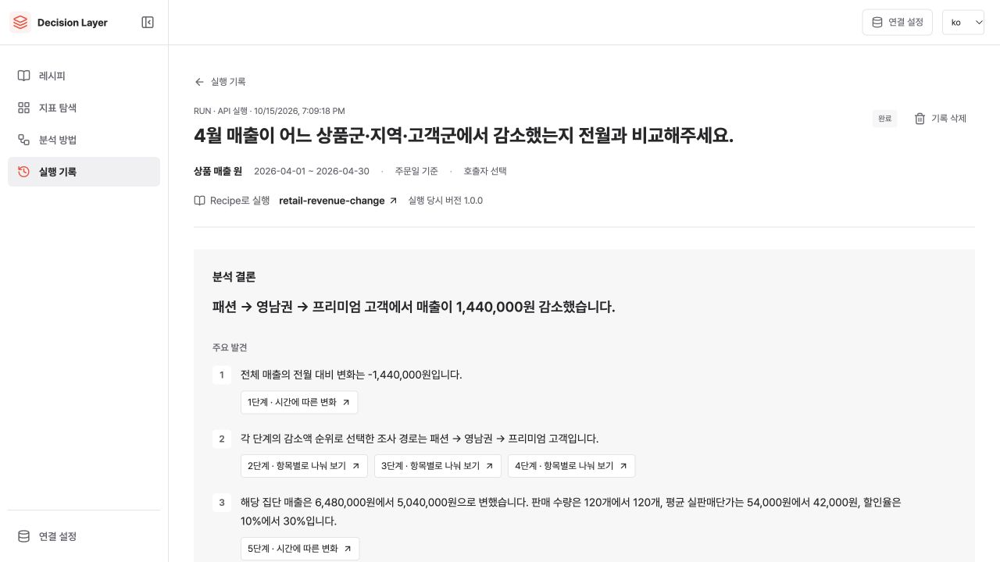
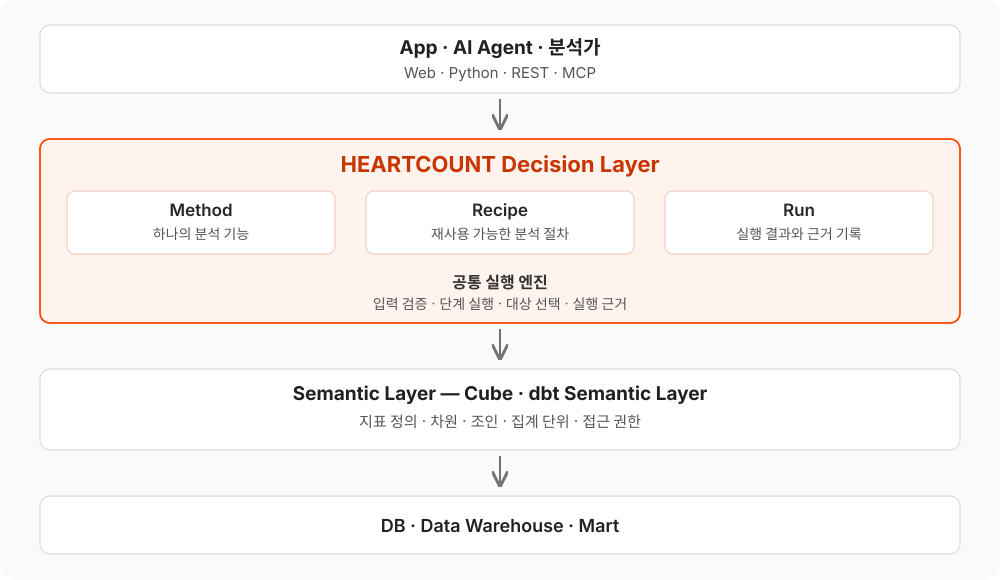
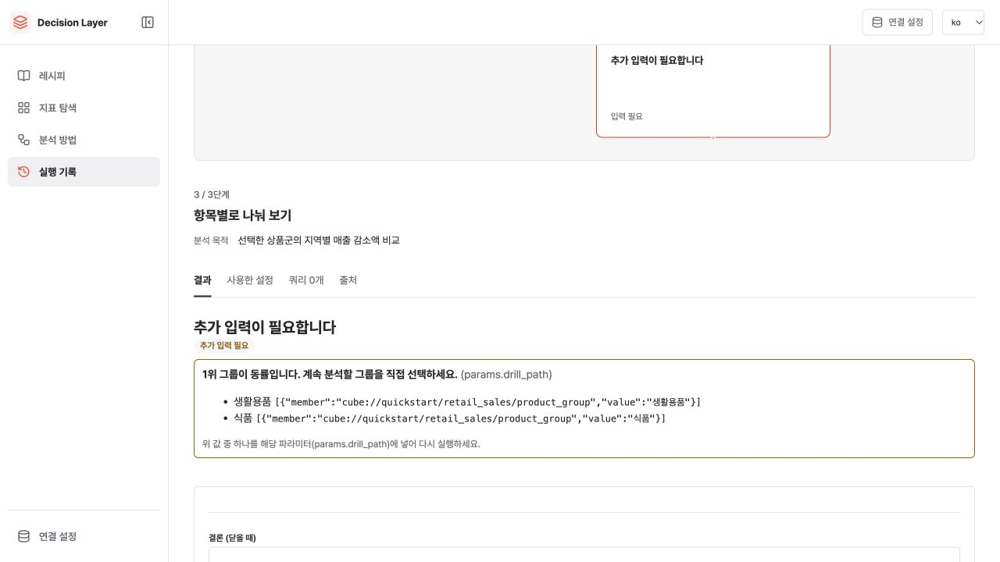
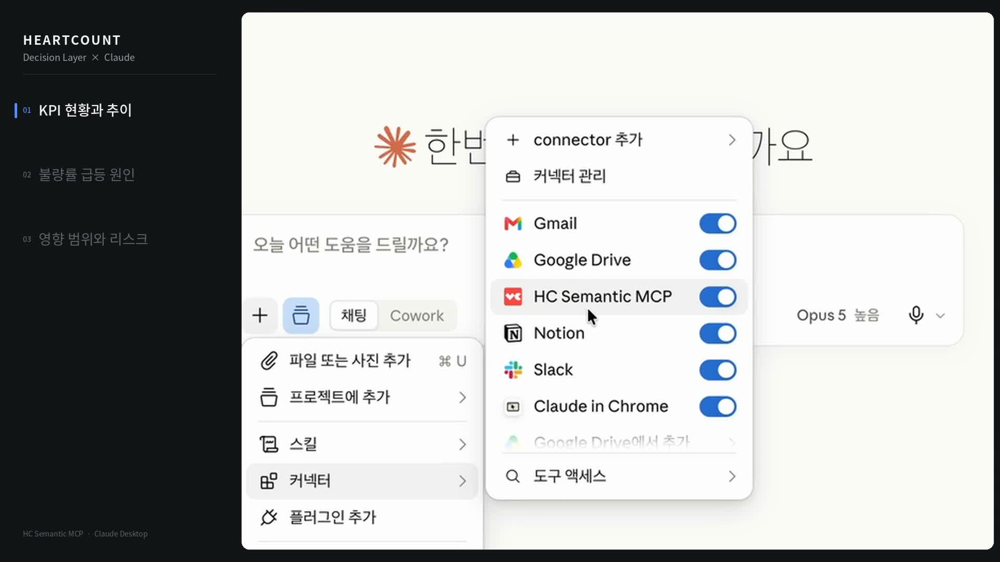

# HEARTCOUNT Decision Layer

**우리 팀의 분석 노하우를 AI가 실행할 수 있는 절차로.**

Decision Layer는 Semantic Layer 위에서 **어떤 지표를 함께 보고, 어떤 순서와 방법으로 분석할지** 관리하는 오픈소스 프레임워크입니다. 조직의 분석 절차를 저장하고, 사람과 AI Agent가 새로운 데이터에 다시 적용할 수 있게 합니다. 실행한 단계와 사용한 데이터, 쿼리, 검증 결과는 함께 기록됩니다.

[문서](https://decision-layer-docs.vercel.app/ko/) · [빠른 시작](#5-decision-layer-실행하기) · [활용 예시](#6-어떻게-활용하나요) · [English](README.en.md) · [도입 문의](mailto:support@idk2.co.kr)

설치 없이 먼저 보기: [매출 분석 화면](#실제-예시-같은-절차로-달라진-조사-대상-찾기) · [Claude + Semantic MCP 영상](https://community.heartcount.io/ko/manufacturing-decision-intelligence-bga/)

## 1. 이게 뭔가요?

“이번 달 매출이 왜 줄었나요?”라는 질문에 숙련된 분석가는 숫자 하나만 조회하지 않습니다. 비교 기간을 정하고, 상품군·지역·고객군을 좁혀 가며, 판매 수량과 단가·할인율을 함께 확인합니다.

Decision Layer는 이러한 **절차 지식**(procedural knowledge)을 실행 가능한 Recipe로 관리합니다. 검토한 분석을 Recipe로 저장하면, 다음 달에도 같은 절차를 사용하면서 조사 대상은 새 데이터에 따라 다시 선택할 수 있습니다.

> 절차는 재사용하고, 답은 현재 데이터로 다시 계산합니다.

### 실제 예시: 같은 절차로 달라진 조사 대상 찾기

아래는 합성 소매 데이터를 로컬 PostgreSQL·Cube에 연결해 실행한 화면입니다. 4월 분석에서는 **패션 → 영남권 → 프리미엄 고객**을 조사하고, 매출과 함께 수량·단가·할인율을 확인했습니다. 같은 Recipe를 3월에 적용하면 다른 집단을 선택하고, 5월에는 감소액 동률로 추가 입력을 요청합니다. [기간별 결과와 절차 보기](#우리-팀의-분석-절차를-recipe로-구성하기)



## 2. 왜 필요한가요? 무엇이 다른가요?

### 신뢰할 수 있는 AI 분석에는 실행 구조가 필요합니다

AI 분석을 업무에 사용하려면 분석에 필요한 입력, 조사 순서와 방법, 결과를 검증하는 기준을 정해야 합니다. 입력이 부족하거나 조사 대상이 모호할 때는 추가 정보를 요청하도록 해야 합니다.

Decision Layer는 이러한 기준을 분석 절차에 적용하고, 실제 입력·선택 경로·쿼리·결과·검증 기록을 남깁니다. 팀의 분석 노하우를 사람과 AI가 재사용하고, 실행 과정을 확인할 수 있게 합니다.

### Semantic Layer가 있어도 분석 절차는 필요합니다

Semantic Layer는 매출의 정의, 집계 방식, 상품·고객·지역의 관계를 관리합니다. AI는 이를 통해 일관된 지표를 조회할 수 있습니다. 하지만 지표의 정의만으로는 다음 질문까지 정해지지 않습니다.

- 매출과 함께 판매 수량, 주문 수, 단가 중 무엇을 확인할 것인가?
- 상품군·지역·고객군 중 어떤 차원부터 살펴볼 것인가?
- 매출 규모가 큰 집단과 감소액이 큰 집단 중 어디를 먼저 조사할 것인가?
- 조사 대상이 동률이거나 필요한 입력이 빠졌을 때 어떻게 할 것인가?

이 절차가 매번 AI의 판단에만 맡겨지면, 같은 질문에도 비교 기준과 분석 경로가 달라질 수 있습니다. Decision Layer는 팀이 합의한 절차를 명시하고, 실제 실행이 그 절차를 따랐는지 확인할 수 있게 합니다.

두 계층을 함께 사용하면 **지표의 의미와 분석 절차를 각각 관리**할 수 있습니다. 지표 계산식과 조인·권한은 Semantic Layer에 두고, Decision Layer는 그 정의를 참조합니다.

예를 들어, 같은 데이터에 다음 질문을 한다고 해보겠습니다.

> **4월 매출이 전월보다 왜 줄었어? 어디부터 확인해야 해?**

| 구분 | Semantic Layer만 연결 | Decision Layer도 연결 |
| --- | --- | --- |
| 지표 계산 | 회사가 정의한 매출·수량·단가를 조회 | 같은 지표 정의를 사용 |
| 분석 순서 | 별도 절차를 구현하지 않았다면 Agent가 질문과 지침을 바탕으로 계획을 구성 | 저장된 Recipe에 따라 상품군 → 지역 → 고객군 순서로 조사 |
| 조사 대상 | Agent가 질문과 지침을 해석해 선택 | 이 예제에서는 각 단계에서 전월 대비 감소액이 가장 큰 집단을 선택 |
| 실행 근거 | Agent와 도구의 로그 구현에 따라 다름 | Run(분석 실행 기록)에 실제 입력·선택 경로·쿼리·결과·검증 기록을 보존 |

Semantic Layer만 연결해도 같은 결과에 도달할 수 있습니다. Decision Layer의 가치는 팀이 합의한 분석 절차를 재사용하고, 실제로 어떻게 실행됐는지 확인할 수 있다는 데 있습니다.

### SKILL.md와는 무엇이 다른가요?

SKILL.md로도 분석 지침을 전달하고, 스크립트나 도구를 묶을 수 있습니다. Decision Layer는 지침을 실행할 때 필요한 입력·단계 연결·검증·기록을 공통 실행 엔진에서 관리합니다.

| 구분 | SKILL.md 중심의 구성 | Decision Layer |
| --- | --- | --- |
| 절차 표현 | 자연어 지침과 연결된 코드·도구 | Method와 지표 참조로 구성한 Recipe |
| 입력과 단계 연결 | 사용하는 도구·스크립트에서 구현 | 입력 타입과 이전 단계의 선택 결과를 계약으로 관리 |
| 실행과 근거 | 구성에 따라 별도로 구현 | Run(분석 실행 기록)에 적용 입력, Method·Recipe 버전, 쿼리와 경고를 기록 |
| 여러 인터페이스에서 사용 | 클라이언트와 연결 방식에 따라 구성 | Web·Python·REST·MCP가 같은 실행 모델 사용 |

둘은 함께 사용할 수 있습니다. Skill은 “언제 이 분석을 사용할지”를 안내하고, Decision Layer는 해당 Recipe를 실행하는 도구가 될 수 있습니다. 같은 절차를 적용한다는 것은 분석 경로와 기준을 관리한다는 뜻이며, AI의 설명 문장이나 분석적 정답을 보장한다는 뜻은 아닙니다.

## 3. 누구를 위한 도구인가요?

주 독자는 **정형 데이터 분석 Agent를 만드는 개발자와 데이터 플랫폼 팀**입니다. 분석가와 업무 전문가가 정의한 절차를 Recipe로 관리하고, 현업 사용자와 AI Agent가 실행하고 근거를 확인할 수 있게 합니다.

| 역할 | 담당자 | 하는 일 |
| --- | --- | --- |
| 연결·운영 | 개발자·데이터 플랫폼 팀 | Semantic Source와 App·Agent 연결, 실행 환경 구성 |
| 절차 작성·검토 | 분석가·업무 전문가, 필요시 개발자와 협업 | 함께 볼 지표, 조사 순서, 분석 방법, 선택 규칙을 Recipe로 정의 |
| 분석 사용 | 현업 사용자·분석가 | Web·Agent·App으로 질문하고 결과·근거 검토 |

매출뿐 아니라 비용, 고객 이탈, 운영 품질 등 반복해서 조사하는 업무 질문에 적용할 수 있습니다. 업무별 지표와 적절한 분석 절차를 먼저 정의해야 합니다.

## 4. 어떻게 구성되어 있나요?

**DB·DW·Mart ↔ Semantic Layer ↔ Decision Layer ↔ Agent·App**



| 계층 | 역할 |
| --- | --- |
| **DB·DW·Mart** | 원천 데이터와 정제·통합한 분석 데이터 저장 |
| **Semantic Layer** | 지표 정의·계산식·차원·관계·집계 기준과 데이터 조회 권한 관리 |
| **Decision Layer** | 분석 순서·방법·선택 규칙 관리, 실행·검증·근거 기록 |
| **Agent·App** | 질문이나 감시 조건에 맞는 분석 요청, 결과 설명·전달 |

데이터 조회 권한은 Semantic Layer에서 집행하도록 구성하고, 원천 DB 권한으로 뒷받침합니다. 조직의 로그인·SSO에서 확인한 사용자 신원이 조회까지 이어져야 합니다. **Recipe를 누가 수정하고 저장된 Run(분석 실행 기록)을 누가 볼지**는 Decision Layer·App 측에서 별도로 관리해야 하는 권한입니다. 현재 운영 권한 범위는 [아래 제약 사항](#7-어떻게-발전할-계획인가요)을 확인하세요.

Decision Layer의 핵심 구성 요소는 다음 세 가지입니다.

| 구성 요소 | 의미 |
| --- | --- |
| **Method** | 집계, 기간 비교, 드릴다운 등 하나의 분석 기능 |
| **Recipe** | Method와 지표 참조를 묶은 재사용 가능한 분석 절차 |
| **Run(분석 실행 기록)** | 한 번의 분석에 적용한 입력·기간·선택 경로·버전·쿼리·결과·검증 기록 |

같은 Recipe를 3월과 4월에 실행하면 Run(분석 실행 기록)은 각각 생깁니다. Run(분석 실행 기록)은 실행 중이거나 추가 입력을 기다리는 상태도 포함합니다.

현재 Semantic Source로 **Cube REST API**와 **공식 dbt Semantic Layer GraphQL API**를 지원합니다. 기본 조회 Method는 집계, 추이·기간 비교, 드릴다운입니다. 새로운 Method는 Python으로 추가할 수 있습니다.

Web·Python·REST·MCP는 같은 실행 엔진을 사용합니다. AI는 등록된 Method와 Recipe를 선택하고 결과를 설명하며, 분석 실행은 이 엔진의 입력 검증과 실행 규칙을 거칩니다.

Agent는 다음 두 방식으로 활용할 수 있습니다.

- **질문 응답:** 질문 해석 → 지표·기간 확인 → Recipe 선택 또는 등록된 Method로 탐색 → 분석 요청 → 결과·근거 설명.
- **상시 분석(향후 계획):** 주기·이벤트에 따라 변화 확인 → 적합한 Recipe로 조사 → 중요한 결과를 보고서·알림으로 전달. 같은 지표 정의·권한·분석 절차를 활용하는 방향입니다.

[아키텍처 자세히 보기](docs/ko/ARCHITECTURE.md) · [Method 개발 가이드](docs/ko/guides/methods.md) · [Recipe 가이드](docs/ko/guides/recipes.md)

## 5. Decision Layer 실행하기

원하는 체험 수준부터 시작하세요.

| 체험 방법 | 준비할 것 |
| --- | --- |
| 화면·영상으로 살펴보기 | [매출 분석 화면](#실제-예시-같은-절차로-달라진-조사-대상-찾기) 또는 [Claude 활용 영상](https://community.heartcount.io/ko/manufacturing-decision-intelligence-bga/) 열기. 설치 없이 볼 수 있습니다. |
| Web 샘플 실행 | Git과 실행 중인 Docker Compose v2 |
| AI 클라이언트 연결 | Web 샘플 준비 환경에 Node.js·Claude Code 추가, 또는 클라이언트별 MCP 설정 |

### 샘플 데이터로 먼저 체험하기

**Git과 실행 중인 Docker Compose v2**를 준비한 뒤 실행하세요.

```bash
git clone https://github.com/haechangcho/decision-layer.git
cd decision-layer
bash scripts/demo.sh
```

PostgreSQL·Cube·Decision Layer API·Web과 작은 합성 상점 샘플을 준비합니다. 이 스크립트 데모에는 회사 데이터나 모델 API 키, 로컬 Python 설치가 필요 없습니다. 첫 실행은 이미지와 패키지를 내려받으므로 몇 분 이상 걸릴 수 있습니다.

실행 후 [Web에서 분석 기록 보기](http://localhost:3100/runs)를 여세요.

| 기본 샘플 | 확인할 동작 |
| --- | --- |
| 1월 | 매출 1위 Home을 선택하고 지역별 매출 조사 |
| 2월 | 같은 Recipe가 새 1위 Grocery를 선택하고 지역별 매출 조사 |
| 3월 | 두 부문이 동률이면 지역 조회 전에 추가 입력 요청 |

```bash
# 새 실행 기록을 만들며 샘플 다시 실행
bash scripts/demo.sh replay

# 데이터는 보존하고 서비스 종료
bash scripts/demo.sh stop
```

### Claude Code에서 질문하기

Node.js와 Claude Code도 준비되어 있다면, 복제한 저장소에서 다음 명령으로 샘플 준비와 MCP 등록을 진행할 수 있습니다.

```bash
node scripts/install.mjs setup --client claude
```

Claude Code를 다시 시작한 뒤 질문하세요. 모델 연결은 AI 클라이언트에서 별도로 준비합니다.

> 저장된 부문 분석 절차를 2026년 2월에 재사용해줘. 매출 1위 부문을 찾고 그 부문의 지역별 매출을 확인해줘. 근거와 한계도 설명해줘.

[설정·종료·제약 사항](examples/quickstart/README.ko.md) · [Codex 등 MCP 클라이언트 연결](docs/ko/guides/mcp.md)

## 6. 어떻게 활용하나요?

### 회사의 Semantic Layer 연결하기

DB·Mart의 지표와 차원을 Semantic Layer에 정의한 뒤, Decision Layer에 소스를 연결합니다. 예를 들어 매출 분석에는 매출, 판매 수량, 주문 수, 실판매단가, 할인율과 상품군·지역·고객군을 준비할 수 있습니다.

이미 운영하는 Cube나 dbt Semantic Layer가 있다면 기존 정의를 활용하세요. Semantic Layer 구축이나 기존 SQL·Mart의 모델링에 도움이 필요하면 [support@idk2.co.kr](mailto:support@idk2.co.kr)로 문의해 주세요.

[Cube 연결 가이드](docs/ko/guides/cube.md) · [dbt 연결 가이드](docs/ko/guides/dbt.md)

### 우리 팀의 분석 절차를 Recipe로 구성하기

기존 Method를 조합해 Recipe를 만들거나, 유용했던 Run(분석 실행 기록)을 검토한 뒤 Recipe로 저장합니다. Web에서 구성하고 YAML로 세부 설정을 관리할 수 있습니다. AI 코딩 도구로 Recipe와 Python Method 초안을 작성하는 것도 가능합니다. 업무 기준에 맞는지 검토한 뒤 등록해 사용하세요.

다음은 **6개월치 합성 소매 데이터**로 구성하고 로컬 PostgreSQL·Cube에서 실행한 매출 변화 분석 예시입니다. 위의 설치용 기본 샘플과는 별도의 데이터·Recipe를 사용합니다. 이 확장 예제의 데이터·모델·Recipe와 지원 코드 변경은 아직 GitHub main에 배포하지 않았습니다.

> 이번 달 매출은 전월과 비교해 어디서 줄었나요? 상품군 → 지역 → 고객군 순서로 좁혀 보고, 판매 수량·실판매단가·할인율을 함께 확인해 주세요.

Recipe에는 다음 절차를 저장합니다.

1. 이번 달과 전월의 전체 매출 및 관련 지표를 비교합니다.
2. 매출 감소액이 가장 큰 상품군을 찾습니다.
3. 선택한 상품군 안에서 감소액이 가장 큰 지역을 찾습니다.
4. 그 지역 안에서 감소액이 가장 큰 고객군을 찾습니다.
5. 최종 집단의 수량·단가·할인율을 비교합니다. 선택 대상이 동률이면 추가 입력을 요청합니다.

| 같은 Recipe를 적용한 기간 | 조사 대상 | 확인한 내용 |
| --- | --- | --- |
| 3월 vs. 2월 | 가전 → 수도권 → 기업 고객 | 매출 3,240만 → 1,620만 원. 수량 240 → 120개, 단가 동일 |
| 4월 vs. 3월 | 패션 → 영남권 → 프리미엄 고객 | 매출 648만 → 504만 원. 수량 동일, 할인율 10% → 30% |
| 5월 vs. 4월 | 생활용품·식품의 감소액 동률 | 각각 162만 원 감소. 조사할 상품군을 묻고 지역 조회는 대기 |

**저장하는 것은 특정 상품군의 이름이 아니라, 매번 현재 데이터에서 조사 대상을 선택하는 규칙입니다.**

<details>
<summary>5월: 동률이면 어떻게 되나요?</summary>

생활용품과 식품의 감소액이 같아 조사할 상품군을 선택하도록 요청합니다. 입력을 기다리는 동안 지역·고객군 조회는 실행하지 않습니다.



</details>

이 예시는 분석 절차의 재사용을 보여주기 위해 설계한 합성 데이터입니다. 수량·단가 등의 변화는 관측 결과이며, 변화가 발생한 업무 원인까지 입증한 것은 아닙니다.

### MCP 또는 API로 App·Agent에 연결하기

등록한 지표와 Recipe를 App에서 사용하려면 REST API 또는 Python 인터페이스를, AI 클라이언트에서 사용하려면 제공되는 MCP 어댑터를 연결합니다. Web과 같은 분석 실행 모델을 사용하므로 결과와 근거를 함께 확인할 수 있습니다.

이 저장소의 MCP 어댑터는 **로컬 stdio 방식**이며 Claude Code·Codex 등의 연결 설정을 제공합니다. HEARTCOUNT Semantic MCP와의 연계나 조직 환경에 맞는 App 연결은 별도로 구성합니다.

[MCP 연결 안내](docs/ko/guides/mcp.md)

### 직접 App을 개발하기 어렵다면

HEARTCOUNT의 **Semantic MCP와 전용 Decision Agent를 활용하는 도입 방식**도 상담할 수 있습니다. 기관·조직의 데이터 연결, Semantic Layer 모델링, 업무별 Recipe 구성과 Agent 연계에 도움이 필요하면 [support@idk2.co.kr](mailto:support@idk2.co.kr)로 연락해 주세요.

아래는 **Claude와 HEARTCOUNT Semantic MCP를 연결한 제조 분석 데모**입니다. 연결 화면과 KPI 확인·분석 흐름을 영상으로 볼 수 있습니다.

[](https://community.heartcount.io/ko/manufacturing-decision-intelligence-bga/)

[활용 사례와 영상 보기](https://community.heartcount.io/ko/manufacturing-decision-intelligence-bga/)

이 영상은 HEARTCOUNT의 별도 활용 사례이며, 이 저장소의 설치용 샘플 실행 영상과는 다릅니다.

## 7. 어떻게 발전할 계획인가요?

| 단계 | 방향 | 확인할 결과 |
| --- | --- | --- |
| 현재 제공 | Semantic Source 연결, Method·Recipe 실행, Run(분석 실행 기록)과 근거 기록 | 같은 절차를 새 기간에 실행하고 적용값·쿼리·검증 기록 확인 |
| 우선 개선 | 확장 매출 예제의 재현 파일 공개, 역할별 시작 안내와 근거 검토 흐름 개선 | 새 환경에서도 예제를 재현하고, 실행 과정과 필요한 추가 입력을 확인 |
| 검토 | 설치 없이 체험할 수 있는 호스팅 데모 | 로컬 실행 환경을 준비하기 전에 분석·근거 확인 흐름 체험 |
| 확장 | 산업·업무별 Recipe와 Method 확대 | 매출·고객·비용·운영 등 반복 질문에 적용 가능한 예제 |
| 확장 | Always-on Analytical Agent | 의미 있는 변화 감지 → Recipe로 조사 → 근거가 포함된 보고서 전달. 반복 알림을 줄이고 검토할 변화에 집중 |

현재 제공 외 항목은 향후 방향이며 제공 시기는 정하지 않았습니다. **현재는 공개 호스팅 데모와 Always-on 분석을 제공하지 않습니다.**

조직 도입 시에는 사용자 인증·데이터 권한 연결과 분석 자산 권한을 별도로 구성해야 합니다. 로컬 샘플은 공통 서비스 계정을 사용합니다. 별도의 Recipe 작성자·편집자 권한은 아직 구현되지 않았으므로 현재 Web·API는 로컬 또는 신뢰할 수 있는 사설 환경에서 사용하세요. [권한 설계 범위](docs/DECISIONS.md#adr-038--defer-recipe-author-authorization-to-application-login)

적용하고 싶은 업무나 필요한 분석 기능은 [GitHub Issues](https://github.com/haechangcho/decision-layer/issues)에서 제안해 주세요.

## 함께 읽으면 좋은 글

- [SQL 자산을 활용한 규칙 기반 시멘틱 모델링](https://community.heartcount.io/ko/sql-to-semantic-layer-2/) — 기존 SQL을 Semantic Layer 모델로 연결하는 HEARTCOUNT의 접근을 소개합니다.
- [믿어도 되나요 AI의 숫자를](https://community.heartcount.io/ko/semantic-mcp-decision-agent/) — AI의 답변을 지표 정의·업무 규칙·권한·근거와 연결해야 하는 이유를 설명합니다.

## 개발과 기여

분석 Method, 업무별 Recipe, 재현 가능한 예제, 문서 개선에 기여할 수 있습니다. Method 개발은 Python 3.11 이상에서 시작할 수 있습니다.

[작은 기여 과제](docs/guides/contribute-examples.md) · [Method 개발](docs/ko/guides/methods.md) · [개발 환경](docs/ko/guides/development.md) · [기여 안내](CONTRIBUTING.md)

## 평가 범위

이 README의 실행 화면은 절차 재사용과 실행 근거를 보여주는 합성 데이터 예시입니다. 분석의 타당성은 지표 정의, 데이터 품질, 선택한 절차와 방법의 가정에 달려 있습니다.

기존 18회 파일럿에서는 상세 지침을 받은 Semantic MCP와 저장된 Recipe를 사용한 Decision Layer 모두 숫자 검사 9/9, 동률 시 입력 요청 3/3을 통과했습니다. Decision Layer의 토큰 사용량·추정 비용·지연은 더 컸습니다. 이 작은 실험으로 정확도 우위나 비용 절감을 주장하지 않습니다. [결과와 한계](docs/guides/benchmark-pilot.md)

후속 평가에서는 절차 준수율, 사용자 수정 횟수, 근거 검토 시간과 실행 비용을 함께 확인할 계획입니다. [평가 방법](docs/ko/guides/evaluation.md)

## 도입 문의 · 라이선스

**기관·조직에 직접 도입하고 싶거나, Semantic Layer·Recipe·Agent 구성에 도움이 필요하신가요?**

[support@idk2.co.kr](mailto:support@idk2.co.kr)로 사용 목적과 현재 데이터 환경을 알려 주세요.

오픈소스 라이선스: [Apache 2.0](LICENSE)
