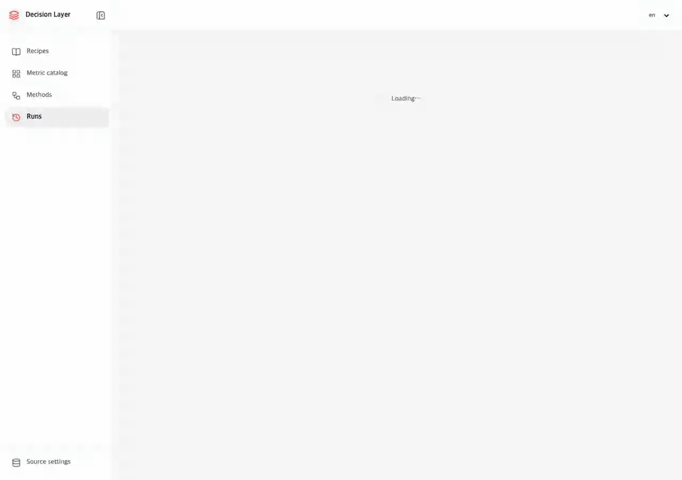

# Decision Layer

[문서](https://decision-layer-docs.vercel.app/ko/) · [English](README.md) · [빠른 시작](examples/quickstart/README.ko.md)

**우리 팀의 분석 방식을 AI에게 가르치세요.**

검토한 분석을 실행 단계·검증·근거가 남는 재사용 절차로 만듭니다.
절차를 저장하고 새 기간에 다시 적용하세요. 이전 답을 그대로 복사하지 않습니다.
여기서 ‘가르친다’는 모델 학습이 아니라 실행 가능한 Recipe 저장을 뜻합니다.



## 먼저 확인하세요

작은 합성 상점 데이터에서 매출 1위 부문을 찾고, 그 부문의 지역별 매출을 조사합니다.

| 실행 | 결과 |
| --- | --- |
| 1월 | Home 매출 6,200 → Home의 지역 조사 |
| 저장 | 분석을 Recipe로 등록 |
| 2월 | 같은 Recipe가 Grocery 매출 6,720을 선택 → Grocery의 지역 조사 |
| 3월 | 두 부문 동률 → 지역 선택 전에 추가 입력 요청 |

공통 실행 엔진으로 실제 Cube를 조회합니다. 스크립트와 합성 데이터를 이용한 제품 데모이며
AI 정확도 벤치마크는 아닙니다.

## 실행하기

Node.js, Git, Claude Code와 실행 중인 Docker Compose v2가 필요합니다.

```bash
git clone https://github.com/haechangcho/decision-layer.git
cd decision-layer
node scripts/install.mjs setup --client claude
```

설치가 샘플 준비·재실행 검증·MCP 등록을 처리합니다. Claude Code를 다시 시작하고
아래 질문을 하세요. **Python 설치, MCP JSON 편집, 포트 설정은 필요 없습니다.**
Docker는 실행 중이어야 하며 첫 빌드는 몇 분 이상 걸릴 수 있습니다.
웹은 [근거를 확인할 때](http://localhost:3100/runs) 열면 됩니다.

Claude Code 없이 제품만 체험하려면 `bash scripts/demo.sh`를 실행하세요.
[설정·종료 안내](examples/quickstart/README.ko.md) · [더 큰 소매 데이터 예제](examples/complete-journey/README.ko.md)

## AI에서 사용하기

설치 후 Claude Code에서 질문하세요.

> 저장된 부문 분석 절차를 2026년 2월에 재사용해줘. 매출 1위 부문을 찾고 그 부문의
> 지역별 매출을 확인해줘. 근거와 한계도 설명해줘.

[복사할 MCP 설정](examples/quickstart/README.md#ask-your-ai)을 참고하세요.
회사 데이터는 [Cube](docs/ko/guides/cube.md) 또는 [dbt Semantic Layer](docs/ko/guides/dbt.md)로 연결합니다.

## 시맨틱 MCP에 무엇을 더하나요?

시맨틱 레이어는 지표의 의미를 관리하고 분석 지침은 AI의 조사를 안내합니다.
Decision Layer는 등록된 Method, 입력 검증, 선택 규칙, 실행 근거를 갖춘 절차를 실행합니다.

- **규칙 재사용:** 지난번 1위 이름 대신 이번 실행의 1위를 선택합니다.
- **실행 확인:** Method 버전·적용 입력·쿼리·경고를 기록합니다.
- **부족한 근거 처리:** 지원되는 검증에 따라 입력을 요청하거나 실행을 거절합니다.
- **동일한 실행 모델:** Web·Python·REST·MCP가 같은 엔진을 사용합니다.

검증이 모든 분석적 정답을 보장하지는 않습니다. 잘못된 절차는 잘못된 답을 낼 수 있고,
관측된 관계는 인과관계의 증명이 아닙니다. [평가 안내](docs/ko/guides/evaluation.md)를 참고하세요.

## 구성과 기여

**Method**는 하나의 분석 기능, **Recipe**는 재사용 절차, **Run**은 실행과 근거의 기록입니다.
지표 수식·조인·권한은 시맨틱 공급자가 관리합니다. AI는 등록된 Method와 Recipe를 선택하며,
생성한 분석 Python·SQL을 실행하지 않습니다. 먼저 탐색하고 유용한 Run을 Recipe로 저장할 수 있습니다.

[작은 기여 과제](docs/guides/contribute-examples.md)부터 시작하세요.
Method 개발에는 Python 3.11 이상이면 충분합니다.

```bash
make setup
make example
```

[Method 가이드](docs/ko/guides/methods.md) · [기여 안내](CONTRIBUTING.md) ·
[개발 환경](docs/ko/guides/development.md) · [아키텍처](docs/ko/ARCHITECTURE.md)

[Apache 2.0](LICENSE)

### 실측 벤치마크

18회 파일럿에서 Decision Layer의 토큰 사용량·추정 비용·지연이 더 컸습니다. [실험 결과와 한계, 개선 액션](docs/guides/benchmark-pilot.md)을 공개합니다. 숫자 일치만으로 정확도 우위를 주장하지 않습니다.
