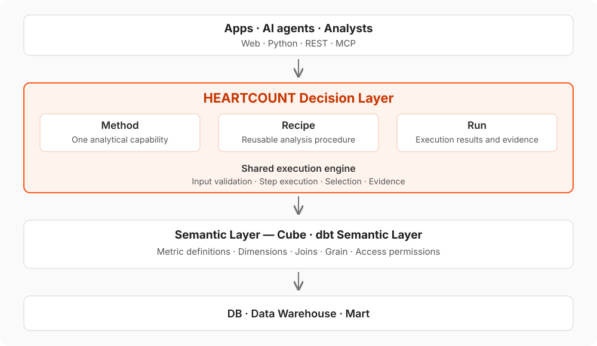

# HEARTCOUNT Decision Layer

**Turn your team's analytical know-how into procedures AI can run.**

Decision Layer is an open-source framework that sits above a semantic layer and defines **which metrics to examine, in what order, and with which analytical methods**. Save your team's analysis procedures and let analysts and AI agents apply them to fresh data. Each execution records its steps, data references, queries, and validation results.

[Documentation](https://decision-layer-docs.vercel.app/) · [Quickstart](#5-run-decision-layer) · [Usage examples](#6-use-it-with-your-data-and-agents) · [한국어](README.ko.md) · [Contact](mailto:support@idk2.co.kr)

## 1. What is it?

When someone asks, “Why did revenue fall this month?”, an experienced analyst does more than look up a number. They choose a comparison period, narrow the investigation by product category, region, and customer segment, and examine units sold, selling prices, and discounts together.

Decision Layer captures this **procedural knowledge** in an executable Recipe. Review an analysis, save its procedure, and reuse it next month. The procedure stays the same; the groups selected for investigation can change with the data.

> Reuse the procedure. Calculate the answer from the current data.

## 2. Why is it needed? How is it different?

### A semantic layer defines metrics. An analysis also needs a procedure.

A semantic layer manages revenue definitions, aggregation rules, and relationships between products, customers, and regions. It gives AI a consistent way to query metrics. Those definitions alone do not settle the next questions:

- Should revenue be examined alongside units sold, order count, or selling price?
- Should the investigation start with product category, region, or customer segment?
- Should it follow the largest group or the group with the largest revenue decline?
- What should happen when candidates tie or a required input is missing?

If the agent makes these choices anew each time, the same question can lead to different comparison criteria and analysis paths. Decision Layer makes your team's procedure explicit and lets you inspect how it was executed.

| | Semantic Layer | Decision Layer |
| --- | --- | --- |
| Core question | What does this metric mean, and how is it calculated? | How should this business question be investigated? |
| Manages | Metric definitions, dimensions, joins, grain, access permissions | Related metrics, analysis dimensions, Methods, step dependencies, selection rules |
| Revenue example | Sum the amount after discounts for completed orders | Compare months, then investigate the largest decline by category → region → customer segment |

Together, the two layers let you manage **metric definitions and analysis procedures separately**. Formulas, joins, and access rules remain in the semantic layer. Decision Layer references those definitions.

### How is this different from SKILL.md?

A SKILL.md can describe an analysis procedure and bundle scripts or tools. Decision Layer provides a shared execution engine for the inputs, step dependencies, validation, and evidence needed to run that procedure.

| | A SKILL.md-based setup | Decision Layer |
| --- | --- | --- |
| Procedure | Natural-language instructions with supporting code and tools | A Recipe composed of Methods and semantic references |
| Inputs and step dependencies | Implemented in the tools and scripts you assemble | Typed inputs and explicit references to earlier selections |
| Execution evidence | Implemented as part of your setup | A Run records resolved inputs, Method and Recipe versions, queries, and warnings |
| Multiple interfaces | Depends on the client and integration | Web, Python, REST, and MCP share one execution model |

They can work together. A skill can explain when to use an analysis, while Decision Layer supplies the tool that executes its Recipe. A consistent procedure makes the analysis path and criteria inspectable; it does not guarantee identical AI wording or an analytically correct answer.

## 3. Who is it for?

**Developers and organizations building AI agents for structured data analysis.**

- **Agent and app developers** who need reusable analysis procedures alongside metric queries.
- **Analysts and domain experts** who want their team and AI agents to reuse established analytical know-how.
- **Data platform teams** who want to build on an existing semantic layer and inspect how analyses were executed.

Use it for recurring questions about revenue, costs, customer churn, or operational quality. Each use case needs appropriate metric definitions and an analysis procedure.

## 4. Architecture and components



| Component | Role |
| --- | --- |
| **Semantic Source** | Connects to metrics and dimensions in Cube or dbt Semantic Layer |
| **Method** | One analytical capability, such as aggregation, period comparison, or drilldown |
| **Recipe** | Your team's reusable analysis procedure, composed of Methods and metric references |
| **Run** | One execution, with its step results and supporting evidence |
| **Shared execution engine** | Validates inputs and scope, executes steps, resolves selections, and records evidence |
| **Web · Python · REST · MCP** | Interfaces for people, applications, and AI agents |

Current semantic providers are **Cube REST API** and the **official dbt Semantic Layer GraphQL API**. The core query Methods cover aggregation, trends and period comparisons, and drilldown. You can add Methods in Python.

AI agents select registered Methods and Recipes and explain the results. Analysis runs through the shared engine; executing AI-generated analytical Python or SQL is outside this execution path.

[Architecture](docs/ARCHITECTURE.md) · [Method development](docs/guides/methods.md) · [Recipe guide](docs/guides/recipes.md)

## 5. Run Decision Layer

### Start with sample data

You need **Git and running Docker with Compose v2**.

```bash
git clone https://github.com/haechangcho/decision-layer.git
cd decision-layer
bash scripts/demo.sh
```

This prepares PostgreSQL, Cube, the Decision Layer API, the Web UI, and a small synthetic store dataset. The scripted demo requires no company data, model API key, or local Python installation. The first build downloads images and packages and can take several minutes.

Open [the Web UI to inspect the Runs](http://localhost:3100/runs).

| Built-in sample | What to look for |
| --- | --- |
| January | Select Home as the highest-revenue department and inspect its regions |
| February | Reuse the Recipe, select the new leader Grocery, and inspect its regions |
| March | Request input when the departments tie, before querying their regions |

```bash
# Replay the sample and create new execution records
bash scripts/demo.sh replay

# Stop the services and preserve the data
bash scripts/demo.sh stop
```

### Ask from Claude Code

If you also have Node.js and Claude Code, run this from the cloned repository to prepare the sample and register its MCP connection:

```bash
node scripts/install.mjs setup --client claude
```

Restart Claude Code, then ask the question below. Configure model access in your AI client separately.

> Reuse the saved department investigation for February 2026. Find the department with the highest revenue, then break down its revenue by region. Explain the evidence and limitations.

[Setup, shutdown, and limitations](examples/quickstart/README.md) · [Connect Codex and other MCP clients](docs/guides/mcp.md)

## 6. Use it with your data and agents

### Step 1: Connect your semantic layer

Define your metrics and dimensions over a database or mart, then connect the semantic source to Decision Layer. For a revenue investigation, you might expose revenue, units sold, order count, average selling price, and discount rate, together with product category, region, and customer segment.

If you already use Cube or dbt Semantic Layer, reuse those definitions. Need help building a semantic layer or modeling existing SQL and marts? Contact [support@idk2.co.kr](mailto:support@idk2.co.kr).

[Connect Cube](docs/guides/cube.md) · [Connect dbt Semantic Layer](docs/guides/dbt.md)

### Step 2: Capture your team's procedure in a Recipe

Compose existing Methods into a Recipe, or review a useful Run and save its procedure as a Recipe. Use the Web UI to build the procedure and YAML for detailed settings. AI coding tools can help draft Recipes and Python Methods; review them against your business rules before registering them.

The following revenue investigation uses **six months of synthetic retail data**, executed locally against PostgreSQL and Cube. It uses a separate dataset and Recipe from the built-in quickstart above. The screenshots retain the original Korean UI labels; the results are summarized in English below.

> Where did revenue fall compared with the previous month? Narrow the investigation by product category → region → customer segment, then compare units sold, average selling price, and discount rate.

The Recipe defines these steps:

1. Compare total revenue and related metrics for the current and previous calendar months.
2. Find the product category with the largest revenue decline.
3. Within that category, find the region with the largest decline.
4. Within that region, find the customer segment with the largest decline.
5. Compare units, selling price, and discount rate for the selected group. Request input if the next group to investigate is tied.

All revenue amounts below are in Korean won (KRW).

| Same Recipe, different period | Investigation path | Findings |
| --- | --- | --- |
| March vs. February | Home appliances → Capital region → Business customers | Revenue: 32.4M → 16.2M KRW. Units: 240 → 120. Selling price unchanged. |
| April vs. March | Fashion → Yeongnam region → Premium customers | Revenue: 6.48M → 5.04M KRW. Units unchanged. Discount rate: 10% → 30%. |
| May vs. April | Household goods and Food tie | Each declines by 1.62M KRW. Ask which category to investigate; regional queries wait. |

**The Recipe stores the rule for selecting a group from the current data. Each execution resolves that rule again.**


<details>
<summary>May: what happens when candidates tie?</summary>

Household goods and Food have equal revenue declines. The Run asks which category to investigate. Regional and customer-segment queries do not execute while input is pending.


</details>

This synthetic dataset was designed to demonstrate procedure reuse. The observed changes in units, prices, and discounts do not establish the underlying business causes.

### Step 3: Connect your app or agent through MCP or an API

Use the REST API or Python interface from your application, or the provided MCP adapter from an AI client. These interfaces use the same execution model as the Web UI, so results and evidence remain inspectable.

This repository's MCP adapter runs **locally over stdio**, with setup instructions for clients including Claude Code and Codex. Integration with HEARTCOUNT Semantic MCP or an organization's application environment requires separate configuration.

[MCP integration guide](docs/guides/mcp.md)

### Step 4: Get help with a dedicated Decision Agent

If you need help building the application, contact us about using **HEARTCOUNT Semantic MCP and a dedicated Decision Agent**. We can discuss data connections, semantic modeling, business-specific Recipes, and agent integration for your organization: [support@idk2.co.kr](mailto:support@idk2.co.kr).

The following manufacturing demo shows **Claude connected to HEARTCOUNT Semantic MCP**, from enabling the connection to reviewing KPIs and investigating changes.

[](https://community.heartcount.io/ko/manufacturing-decision-intelligence-bga/)

[Watch the demo and read the use case (Korean)](https://community.heartcount.io/ko/manufacturing-decision-intelligence-bga/)

This is a separate HEARTCOUNT use case. It is distinct from this repository's built-in quickstart.

## 7. Roadmap

These are **planned directions**, beyond the current installation:

- **Always-on Analytical Agent:** Detect meaningful changes in metrics and data, investigate with appropriate Recipes, and produce reports with supporting evidence. The aim is to focus human attention on useful changes and reduce repetitive alerts.
- **More industry and business Recipes and Methods:** Expand reusable examples and analytical capabilities for recurring questions about revenue, customers, costs, and operations.

Suggest use cases and analytical capabilities through [GitHub Issues](https://github.com/haechangcho/decision-layer/issues).

## Further reading

The following HEARTCOUNT articles are in Korean:

- [Rule-based semantic modeling from existing SQL](https://community.heartcount.io/ko/sql-to-semantic-layer-2/) — HEARTCOUNT's approach to turning existing SQL assets into semantic models.
- [Can you trust AI's numbers?](https://community.heartcount.io/ko/semantic-mcp-decision-agent/) — Why AI answers need metric definitions, business rules, permissions, and traceable evidence.

## Development and contributions

Contribute analytical Methods, business Recipes, reproducible examples, or documentation improvements. Method development requires Python 3.11 or later.

[Small contribution ideas](docs/guides/contribute-examples.md) · [Develop a Method](docs/guides/methods.md) · [Development setup](docs/guides/development.md) · [Contributing](CONTRIBUTING.md)

Analytical validity depends on metric definitions, data quality, the procedure, and the method's assumptions. See the [evaluation guide](docs/guides/evaluation.md) and [pilot results](docs/guides/benchmark-pilot.md) for the current evaluation scope and measured performance.

## Adoption support and license

**Want to deploy Decision Layer in your organization, or need help with semantic modeling, Recipes, or agent integration?**

Email [support@idk2.co.kr](mailto:support@idk2.co.kr) with your use case and current data environment.

Open-source license: [Apache 2.0](LICENSE).
