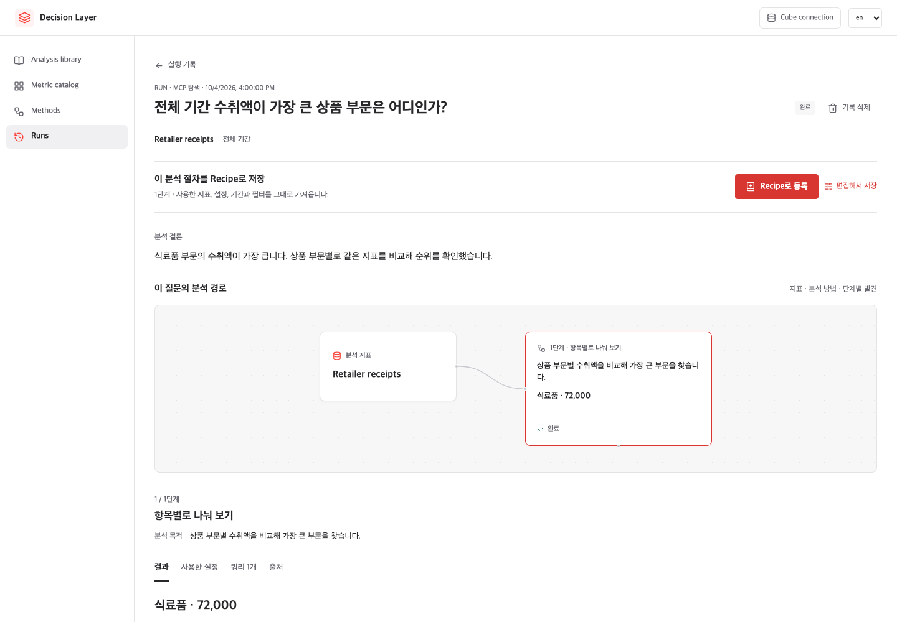

# 실행 기록과 근거

Run은 한 번의 분석 기록입니다. 질문부터 사용한 입력, 쿼리와 결과까지 확인할 수 있습니다.

## 결과 확인하기

**실행 기록**에서 분석을 선택합니다.

1. 질문과 결론을 읽습니다.
2. 분석 단계를 선택해 표와 그래프를 봅니다.
3. **사용한 설정**, **쿼리**, **출처**에서 근거를 확인합니다.

계산이 끝나도 검증에 실패할 수 있습니다. 결과와 함께 경고와 검사 내역을 확인하세요.

## 분석이 멈췄을 때

- **입력 필요**: 빠진 기간이나 변수를 선택합니다.
- **실행 거절**: 검사 사유를 확인하고 입력이나 데이터 조건을 수정합니다.
- **지표 정의 없음**: 담당자가 Cube 모델을 보완한 뒤 새 분석을 실행합니다.

## 다시 사용하거나 삭제하기

완료된 Run에서 **Recipe로 등록**을 선택하면 같은 절차를 재사용할 수 있습니다.

본인의 Run은 실행이 끝난 뒤 삭제할 수 있습니다. 결과와 쿼리는 함께 삭제되며, 이미 등록한 Recipe는 유지됩니다.
